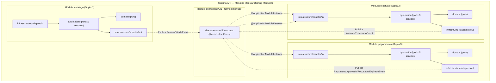
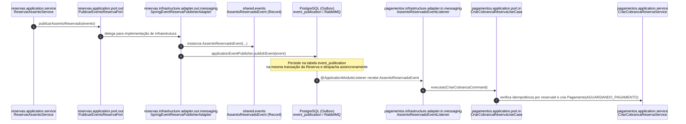

# Guia Definitivo de Arquitetura — `cinema-api`

> **Público-alvo:** Equipe de Engenharia (Dupla 1: `catalogo`, Dupla 2: `reservas`, Dupla 3: `pagamentos`)  
> **Stack Base:** Java 21 (Virtual Threads) • Spring Boot • Spring Modulith • PostgreSQL 16 • Flyway • RabbitMQ • MapStruct • Lombok • ArchUnit

---

## 1. Visão Geral: Como 3 Padrões Arquiteturais Convivem no Mesmo Repositório?

O projeto `cinema-api` combina **três estilos arquiteturais complementares**, onde cada padrão governa uma escala específica do código:

| Escala | Padrão Arquitetural | Onde Aparece no Projeto | Fiscal Automatizado |
| :--- | :--- | :--- | :--- |
| **Macro (Horizontal)** | **Monólito Modular** | Primeiro nível de pacotes (`catalogo`, `reservas`, `pagamentos`, `shared`) | `Spring Modulith` (`ApplicationModules.verify()`) |
| **Micro (Vertical / Interna)** | **Arquitetura Hexagonal (Ports & Adapters)** | Subpastas internas de cada módulo (`domain`, `application`, `infrastructure`) | `ArchUnit` (`archunit-junit5`) |
| **Integração (Assíncrona)** | **Event-Driven Architecture (EDA)** | Contratos em `shared/events/` + Outbox JPA (`event_publication`) / RabbitMQ | `ApplicationModuleListener` + Scenario API |



---

## 2. Visão 1: Onde está o Monólito Modular? (Divisão Macro / Horizontal)

O **Monólito Modular** é materializado no **primeiro nível de pacotes** abaixo de `br.com.cinema`:

```text
src/main/java/br/com/cinema/
├── CinemaApplication.java
├── shared/                 # Kernel Compartilhado (OPEN) — Eventos e primitivos globais
│   ├── package-info.java
│   └── events/
│       └── package-info.java
├── catalogo/               # Bounded Context da Dupla 1 (Filmes, Salas, Sessões)
│   └── package-info.java
├── reservas/               # Bounded Context da Dupla 2 (Assentos da Sessão, Reservas, Ingressos)
│   └── package-info.java
└── pagamentos/             # Bounded Context da Dupla 3 (Cobranças, Transações, Timeout, Gateway)
    └── package-info.java
```

### 2.1. Papel do `package-info.java` com `@ApplicationModule`
Na raiz de cada módulo existe um arquivo `package-info.java`. Ele transforma uma simples pasta do Java em uma **fronteira arquitetural blindada** pelo Spring Modulith:

```java
// src/main/java/br/com/cinema/pagamentos/package-info.java
@org.springframework.modulith.ApplicationModule(
        displayName = "Modulo de Pagamentos (Dupla 3) - Cobrancas, Idempotencia e Expiracao",
        allowedDependencies = {"shared", "shared :: events"}
)
package br.com.cinema.pagamentos;
```

No módulo `shared`, usamos `ApplicationModule.Type.OPEN` e `@NamedInterface("events")` para permitir que os três módulos de negócio importem os contratos de eventos em `br.com.cinema.shared.events`:

```java
// src/main/java/br/com/cinema/shared/package-info.java
@org.springframework.modulith.ApplicationModule(
        type = org.springframework.modulith.ApplicationModule.Type.OPEN,
        displayName = "Shared Kernel - Eventos de Integracao e Contratos Comuns"
)
package br.com.cinema.shared;
```

### 2.2. Regra de Encapsulamento: Por que `pagamentos` é PROIBIDO de importar `reservas`?
1. **Acoplamento Zero entre Duplas:** Em `pagamentos/package-info.java`, a propriedade `allowedDependencies = {"shared", "shared :: events"}` declara explicitamente que `pagamentos` **só conhece `shared`**.
2. **Visibilidade Interna Fechada:** Qualquer subpacote de um módulo (`reservas.domain.*`, `reservas.application.*`, `reservas.infrastructure.*`) é considerado **interno e invisível** para outros módulos.
3. **Bloqueio em Tempo de Teste:** Se alguém na Dupla 3 escrever `import br.com.cinema.reservas.domain.model.Reserva;` ou tentar injetar `ReservaRepository` dentro de `pagamentos`, o teste de verificação do Spring Modulith falha imediatamente quebrando a pipeline:

```java
class ModularityVerificationTest {
    @Test
    void deveRespeitarFronteirasDoMonolitoModular() {
        ApplicationModules modules = ApplicationModules.of(CinemaApplication.class);
        modules.verify(); // Falha se houver import cruzado entre catalogo, reservas e pagamentos!
    }
}
```

### 2.3. Setup de Banco Lógico e Isolamento de Dados (Flyway)
Embora toda a aplicação compartilhe a mesma instância física do PostgreSQL (`cinema_db` no `compose.yaml`), vigoram **três leis inegociáveis de isolamento lógico**:

1. **Propriedade Exclusiva de Tabelas:**
   - **Dupla 1 (`catalogo`):** Dona exclusiva de `filmes`, `salas`, `sessoes`.
   - **Dupla 2 (`reservas`):** Dona exclusiva de `assentos_sessao`, `reservas`.
   - **Dupla 3 (`pagamentos`):** Dona exclusiva de `pagamentos`.
   - **Infraestrutura (`spring-modulith-starter-jpa`):** Gerencia a tabela de Outbox `event_publication`.
2. **Proibição de `FOREIGN KEY` e `JOIN` entre Módulos:**
   - A tabela `pagamentos` possui a coluna `reserva_id UUID NOT NULL`, mas **NÃO possui constraint `REFERENCES reservas(id)`**. A referência entre contextos delimitados (Bounded Contexts) é feita exclusivamente por identidade lógica (`UUID`), permitindo extração futura para microsserviços sem refatoração de banco.
3. **Particionamento de Migrations no Flyway (`ddl-auto: validate`):**
   - `V1__catalogo_init.sql` → Exclusivo da Dupla 1.
   - `V2__reservas_init.sql` → Exclusivo da Dupla 2.
   - `V3__pagamentos_init.sql` → Exclusivo da Dupla 3.
   - `V4__modulith_event_publication.sql` → Tabela de Outbox Transacional do Spring Modulith.

---

## 3. Visão 2: Onde está a Arquitetura Hexagonal? (Divisão Micro / Interna de Cada Módulo)

Ao abrir qualquer um dos 3 módulos (`catalogo`, `reservas` ou `pagamentos`), encontramos internamente a **Arquitetura Hexagonal (Ports & Adapters)**. A regra suprema é a **Inversão de Dependência**: todas as setas de dependência apontam **para dentro (em direção ao `domain`)**.

```mermaid
flowchart TD
    subgraph InfraIn["Driving Adapters (infrastructure/adapter/in)"]
        WEB["web/*Controller.java\nDTOs Request/Response (@Valid)"]
        MSG_IN["messaging/*EventListener.java\n(@ApplicationModuleListener / @RabbitListener)"]
        SCHED["scheduler/*Job.java\n(@Scheduled)"]
    end

    subgraph Application["Camada de Aplicação (application)"]
        PORT_IN["port/in/*UseCase.java\n+ Commands (Records)"]
        SERVICE["service/*Service.java\n(@Service, @Transactional)"]
        PORT_OUT["port/out/*Port.java\n(Interfaces exigidas pelo negócio)"]
    end

    subgraph Domain["Núcleo de Domínio (domain)"]
        MODEL["model/* (Entidades Puras, VOs, Enums)"]
        EX["exception/*DomainException.java"]
    end

    subgraph InfraOut["Driven Adapters (infrastructure/adapter/out)"]
        PERSIST["persistence/*PersistenceAdapter.java\n*JpaEntity + *JpaRepository + *Mapper (MapStruct)"]
        GW["gateway/*GatewayAdapter.java\n(Clientes externos / Fake Adapters)"]
        MSG_OUT["messaging/*EventPublisherAdapter.java\n(ApplicationEventPublisher / RabbitTemplate)"]
    end

    WEB --> PORT_IN
    MSG_IN --> PORT_IN
    SCHED --> PORT_IN
    SERVICE -.->|implementa| PORT_IN
    SERVICE --> MODEL
    SERVICE --> EX
    SERVICE --> PORT_OUT
    PERSIST -.->|implementa| PORT_OUT
    GW -.->|implementa| PORT_OUT
    MSG_OUT -.->|implementa| PORT_OUT
```



### Raio-X das Subpastas Internas de Cada Módulo

#### 1. `domain/` (`domain/model/` e `domain/exception/`)
- **Papel:** Coração do negócio. Contém Entidades Ricas de Domínio (ex: `Pagamento`, `Reserva`, `Sessao`), Value Objects, Enums de máquina de estado (`StatusPagamento`) e Exceções de negócio (`PagamentoExpiradoException`, `TransicaoEstadoPagamentoInvalidaException`).
- **Setup e Restrições (ZERO Dependências Externas):**
  - **PROIBIDO** usar anotações do Hibernate/JPA (`@Entity`, `@Table`, `@Id`, `@Column`, `@OneToMany`).
  - **PROIBIDO** usar anotações do Spring (`@Service`, `@Component`, `@Autowired`, `@Transactional`).
  - **PROIBIDO** importar `org.springframework.*`, `jakarta.persistence.*`, `org.amqp.*` ou bibliotecas de serialização JSON (`com.fasterxml.jackson.*`).
  - Permitido apenas Java padrão (`java.util.*`, `java.time.*`, `java.math.*`) e anotações utilitárias de compilação se estritamente necessário (preferencialmente Java puro com construtores e métodos de fábrica ricos).

#### 2. `application/port/in/`
- **Papel:** Portas de Entrada (Driving Ports). Define **o que** o módulo oferece para quem quiser acioná-lo.
- **Conteúdo:**
  - Interfaces de Casos de Uso (ex: `ProcessarPagamentoUseCase`, `CriarCobrancaReservaUseCase`, `ExpirarPagamentosPendentesUseCase`).
  - Objetos imutáveis (`record`) de entrada/saída da aplicação (ex: `ProcessarPagamentoCommand`, `CriarCobrancaCommand`, `PagamentoResult`) com auto-validação no construtor compacto.

#### 3. `application/port/out/`
- **Papel:** Portas de Saída (Driven Ports). Define contratos (Interfaces) que a camada de aplicação exige do mundo externo para cumprir o caso de uso.
- **Conteúdo:**
  - Interfaces como `SalvarPagamentoPort`, `BuscarPagamentoPort`, `PublicarEventoPagamentoPort`, `GatewayCartaoPort`.
  - **Regra:** As assinaturas das `port/out` recebem e retornam **exclusivamente objetos do `domain` ou `shared/events`**, nunca `*JpaEntity` ou DTOs de terceiros!

#### 4. `application/service/`
- **Papel:** Orquestradores dos Casos de Uso.
- **Conteúdo:**
  - Classes `*Service` (ex: `ProcessarPagamentoService`) que implementam as interfaces de `application/port/in/`.
  - Carregam a entidade de domínio através de uma `port/out` de leitura, acionam o método de negócio rico na entidade (`pagamento.aprovar(...)`), persistem o estado via `port/out` de escrita e disparam eventos via `port/out` de mensageria.
  - Aqui é permitido `@Service` e `@Transactional` do Spring, mas **nunca** acesso direto ao `SpringDataJpaRepository` ou `RabbitTemplate`.

#### 5. `infrastructure/adapter/in/web/`
- **Papel:** Adaptador Primário HTTP REST.
- **Conteúdo:**
  - Controllers anotados com `@RestController` e `@RequestMapping`.
  - DTOs de entrada (`*Request` com Jakarta Bean Validation: `@NotNull`, `@NotBlank`, `@Positive`) e saída (`*Response`).
  - **Regra:** O Controller injeta **apenas a interface `application/port/in/*UseCase`**, converte o `*Request` em `*Command`, executa o caso de uso e devolve `ResponseEntity<*Response>`.

#### 6. `infrastructure/adapter/in/messaging/`
- **Papel:** Adaptador Primário de Mensageria / Eventos Assíncronos.
- **Conteúdo:**
  - Consumidores de eventos anotados com `@Component` e `@ApplicationModuleListener` (ou `@RabbitListener`).
  - Escutam eventos publicados em `shared/events/` (ex: `AssentoReservadoEvent`) e acionam imediatamente uma interface `application/port/in/*UseCase`.

#### 7. `infrastructure/adapter/out/persistence/`
- **Papel:** Adaptador Secundário de Banco de Dados Relacional.
- **Conteúdo:**
  - `*JpaEntity`: Espelho relacional da tabela com anotações do Hibernate (`@Entity`, `@Table`, `@Id`, `@Version`, `@Column`) e Lombok (`@Getter`, `@Setter`, `@NoArgsConstructor`, `@AllArgsConstructor`, `@Builder`).
  - `*JpaRepository`: Interface que estende `JpaRepository<*JpaEntity, UUID>`.
  - `*PersistenceMapper`: Interface `@Mapper(componentModel = "spring")` do **MapStruct** que converte bidirecionalmente entre a Entidade Pura (`domain/model/*`) e a Entidade Relacional (`*JpaEntity`).
  - `*PersistenceAdapter`: Classe `@Component` que implementa as interfaces de banco de `application/port/out/`, utilizando o `*JpaRepository` e o `*PersistenceMapper`.

---

## 4. Visão 3: Onde está o Event-Driven? (Fluxo Assíncrono Entre Pastas)

Como os módulos são proibidos de conversar por chamadas diretas de método ou `JOIN` no banco, toda coordenação entre `catalogo`, `reservas` e `pagamentos` ocorre via **Coreografia Baseada em Eventos (Event-Driven Architecture)**.

### O Caminho Físico de um Evento (Passo a Passo)



1. **Passo 1 — Emissão pelo Domínio/Aplicação (`application/port/out/`):**
   Quando a Dupla 2 conclui a reserva temporária de um assento em `reservas/application/service/ReservarAssentoService.java`, o serviço chama sua porta de saída `PublicarEventoReservaPort`.
2. **Passo 2 — Publicação Transacional (`infrastructure/adapter/out/messaging/` + `shared/events/`):**
   O adaptador de saída constrói o Java `record` imutável localizado em `br.com.cinema.shared.events.AssentoReservadoEvent` e invoca `ApplicationEventPublisher.publishEvent(event)`.
   Graças ao `spring-modulith-starter-jpa` (e `spring-modulith-events-amqp`), o evento é gravado de forma atômica na tabela `event_publication` (Transactional Outbox Pattern) no PostgreSQL junto com o `COMMIT` da reserva, garantindo **entrega pelo menos uma vez (At-Least-Once Delivery)** sem risco de perda de mensagem se o broker oscilar.
3. **Passo 3 — Consumo Assíncrono no Módulo Destino (`infrastructure/adapter/in/messaging/` -> `application/port/in/`):**
   No módulo `pagamentos` (Dupla 3), a classe `AssentoReservadoEventListener` em `pagamentos/infrastructure/adapter/in/messaging/` escuta o evento com `@ApplicationModuleListener`, converte o payload para `CriarCobrancaCommand` e aciona a porta de entrada `CriarCobrancaReservaUseCase` em uma **nova transação independente**.

### Catálogo Oficial de Eventos em `shared/events/`

| Evento (`record` em `br.com.cinema.shared.events`) | Módulo Emissor | Módulo(s) Consumidor(es) | Gatilho de Negócio |
| :--- | :--- | :--- | :--- |
| `SessaoCriadaEvent` | `catalogo` (Dupla 1) | `reservas` (Dupla 2) | Cria o mapa de assentos disponíveis para a nova sessão |
| `AssentoReservadoEvent` | `reservas` (Dupla 2) | `pagamentos` (Dupla 3) | Inicia cobrança com status `AGUARDANDO_PAGAMENTO` e relógio de expiração de 10 min |
| `PagamentoAprovadoEvent` | `pagamentos` (Dupla 3) | `reservas` (Dupla 2) | Confirma a reserva em definitivo e emite o ingresso |
| `PagamentoRecusadoEvent` | `pagamentos` (Dupla 3) | `reservas` (Dupla 2) | Cancela a reserva temporária e libera o assento imediatamente |
| `PagamentoExpiradoEvent` | `pagamentos` (Dupla 3) | `reservas` (Dupla 2) | Timeout de 10 min atingido; cancela a reserva e devolve a poltrona à vitrine |

---

## 5. Fiscalização Automatizada com ArchUnit + Spring Modulith

Para impedir que a arquitetura degrade durante as entregas das 3 duplas, o repositório utiliza testes arquiteturais automatizados em `src/test/java/br/com/cinema/`:

```java
package br.com.cinema;

import com.tngtech.archunit.core.importer.ImportOption;
import com.tngtech.archunit.junit.AnalyzeClasses;
import com.tngtech.archunit.junit.ArchTest;
import com.tngtech.archunit.lang.ArchRule;
import org.junit.jupiter.api.Test;
import org.springframework.modulith.core.ApplicationModules;

import static com.tngtech.archunit.lang.syntax.ArchRuleDefinition.classes;
import static com.tngtech.archunit.lang.syntax.ArchRuleDefinition.noClasses;

@AnalyzeClasses(packages = "br.com.cinema", importOptions = ImportOption.DoNotIncludeTests.class)
class ArchitectureGuardTest {

    // 1. Fiscal Macro: Monólito Modular (Spring Modulith)
    @Test
    void deveValidarFronteirasEntreModulos() {
        ApplicationModules.of(CinemaApplication.class).verify();
    }

    // 2. Fiscal Micro: Pureza do Domínio (Zero Spring / Zero JPA / Zero Infra)
    @ArchTest
    static final ArchRule dominioDeveSerPuro = noClasses()
            .that().resideInAPackage("..domain..")
            .should().dependOnClassesThat()
            .resideInAnyPackage(
                    "..application..",
                    "..infrastructure..",
                    "org.springframework..",
                    "jakarta.persistence..",
                    "org.hibernate.."
            )
            .allowEmptyShould(true)
            .because("A camada domain deve conter apenas Java puro, sem acoplamento com frameworks ou banco de dados.");

    // 3. Fiscal Micro: Aplicação não conhece Infraestrutura
    @ArchTest
    static final ArchRule aplicacaoNaoDeveDependerDeInfraestrutura = noClasses()
            .that().resideInAPackage("..application..")
            .should().dependOnClassesThat()
            .resideInAPackage("..infrastructure..")
            .allowEmptyShould(true)
            .because("A camada application deve depender apenas de domain, shared e de suas próprias ports.");

    // 4. Fiscal Micro: Controllers só podem chamar Ports In
    @ArchTest
    static final ArchRule controllersNaoDevemAcessarServicesOuRepositoriosDiretamente = noClasses()
            .that().resideInAPackage("..infrastructure.adapter.in.web..")
            .should().dependOnClassesThat()
            .resideInAnyPackage("..application.service..", "..infrastructure.adapter.out.persistence..")
            .allowEmptyShould(true)
            .because("Controllers REST devem invocar exclusivamente interfaces em application.port.in.");
}
```
