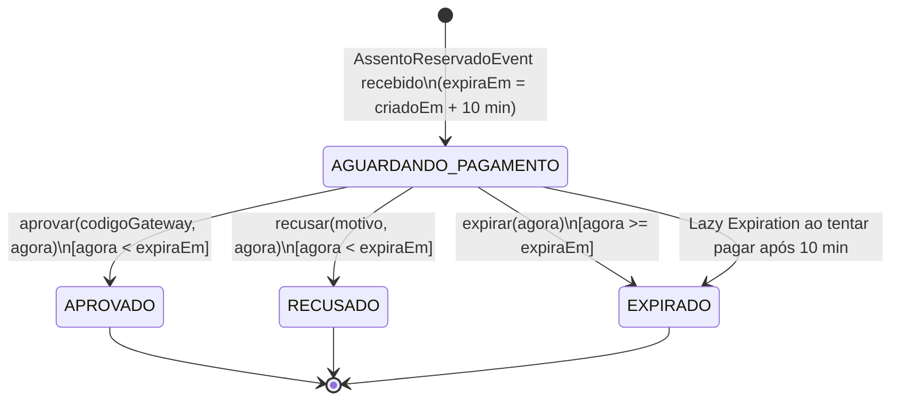
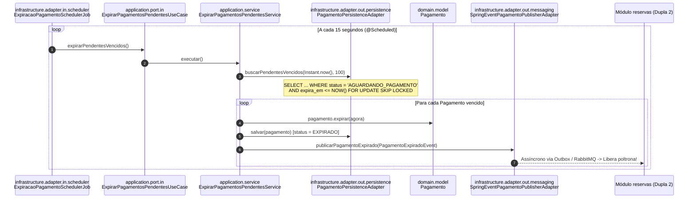

# Especificação Técnica Profunda — Módulo `pagamentos` (Dupla 3)

> **Escopo:** Bounded Context de Pagamentos (`br.com.cinema.pagamentos`)  
> **Responsáveis:** Dupla 3 (Dev A: Domínio, Casos de Uso, Expiração & Persistência | Dev B: Mensageria, Controller REST, Fake Gateway & Testes Integrados)  
> **Agente Especialista Alocado (`ai-agents-core`):** `3.42` (`engineering/engineering-payments-billing-engineer.md`) + `3.06` (`engineering/engineering-backend-architect.md`)

---

## 1. Árvore Completa de Arquivos de `pagamentos`

Abaixo está a lista exata de todos os arquivos `.java` e `.sql` que compõem a entrega da Dupla 3, respeitando rigorosamente o **Spring Modulith** e a **Arquitetura Hexagonal**:

```text
src/main/java/br/com/cinema/
├── shared/
│   ├── package-info.java
│   └── events/
│       ├── package-info.java
│       ├── AssentoReservadoEvent.java                 # Contrato de entrada (emitido pela Dupla 2)
│       ├── PagamentoAprovadoEvent.java                # Contrato de saída (consumido pela Dupla 2)
│       ├── PagamentoRecusadoEvent.java                # Contrato de saída (consumido pela Dupla 2)
│       └── PagamentoExpiradoEvent.java                # Contrato de saída (consumido pela Dupla 2)
│
└── pagamentos/
    ├── package-info.java                              # @ApplicationModule(allowedDependencies = {"shared", "shared :: events"})
    │
    ├── domain/                                        # NÚCLEO PURO (Zero Spring, Zero Hibernate/JPA)
    │   ├── model/
    │   │   ├── Pagamento.java                         # Aggregate Root rico com máquina de estados blindada
    │   │   ├── StatusPagamento.java                   # Enum: AGUARDANDO_PAGAMENTO, APROVADO, RECUSADO, EXPIRADO
    │   │   ├── MetodoPagamento.java                   # Enum: CARTAO_CREDITO, CARTAO_DEBITO, PIX
    │   │   └── DadosCartao.java                       # Value Object imutável (mascarado, sem reter CVV em banco)
    │   └── exception/
    │       ├── PagamentoDomainException.java          # Exceção base do domínio de pagamentos
    │       ├── PagamentoNaoEncontradoException.java   # Quando pagamentoId ou reservaId não existe
    │       ├── PagamentoExpiradoException.java        # Tentativa de pagar cobrança cujo prazo de 10 min venceu
    │       └── TransicaoEstadoPagamentoInvalidaException.java # Tentativa de mudar estado terminal
    │
    ├── application/                                   # ORQUESTRAÇÃO DE CASOS DE USO
    │   ├── port/
    │   │   ├── in/                                    # Driving Ports (Contratos de Entrada)
    │   │   │   ├── CriarCobrancaReservaUseCase.java   # Acionado pelo consumidor do AssentoReservadoEvent
    │   │   │   ├── CriarCobrancaCommand.java          # Record de comando de criação
    │   │   │   ├── ProcessarPagamentoUseCase.java     # Acionado pelo Controller REST de checkout
    │   │   │   ├── ProcessarPagamentoCommand.java     # Record de comando de processamento
    │   │   │   ├── ConsultarPagamentoUseCase.java     # Consulta por pagamentoId ou reservaId
    │   │   │   ├── PagamentoResult.java               # Record de retorno desacoplado do domínio
    │   │   │   └── ExpirarPagamentosPendentesUseCase.java # Acionado pelo Scheduler de timeout (10 min)
    │   │   └── out/                                   # Driven Ports (Contratos de Saída)
    │   │       ├── SalvarPagamentoPort.java           # Persiste/atualiza o Aggregate Pagamento
    │   │       ├── BuscarPagamentoPort.java           # Busca por ID, reservaId ou pendentes vencidos
    │   │       ├── GatewayCartaoPort.java             # Contrato com adquirente/gateway externo
    │   │       ├── RespostaGateway.java               # Record de resposta do gateway (aprovado, codigo, motivo)
    │   │       └── PublicarEventoPagamentoPort.java   # Publica eventos de aprovação, recusa ou expiração
    │   └── service/                                   # Implementações das Ports In (@Service, @Transactional)
    │       ├── CriarCobrancaReservaService.java       # Garante idempotência na criação da cobrança
    │       ├── ProcessarPagamentoService.java         # Orquestra gateway + domínio + outbox event
    │       ├── ConsultarPagamentoService.java         # Leitura otimizada (readOnly = true)
    │       └── ExpirarPagamentosPendentesService.java # Expira em lote cobranças > 10 minutos
    │
    └── infrastructure/                                # DETALHES TÉCNICOS E FRAMEWORKS
        ├── config/
        │   └── PagamentosSchedulingConfig.java        # @Configuration @EnableScheduling
        ├── adapter/
        │   ├── in/
        │   │   ├── web/                               # Driving Adapter REST
        │   │   │   ├── PagamentoController.java       # POST /api/v1/pagamentos/{id}/processar, GET /{id}
        │   │   │   ├── ProcessarPagamentoRequest.java # DTO de entrada com Bean Validation (@Valid)
        │   │   │   ├── PagamentoResponse.java         # DTO de saída HTTP
        │   │   │   └── PagamentoExceptionHandler.java # @RestControllerAdvice com ProblemDetail (RFC 7807)
        │   │   ├── messaging/                         # Driving Adapter de Eventos
        │   │   │   └── AssentoReservadoEventListener.java # @ApplicationModuleListener escutando Dupla 2
        │   │   └── scheduler/                         # Driving Adapter de Timeout
        │   │       └── ExpiracaoPagamentoSchedulerJob.java # @Scheduled aciona ExpirarPagamentosPendentesUseCase
        │   └── out/
        │       ├── persistence/                       # Driven Adapter JPA / PostgreSQL
        │       │   ├── PagamentoJpaEntity.java        # @Entity @Table(name = "pagamentos") + @Version
        │       │   ├── SpringDataPagamentoRepository.java # JpaRepository + queries customizadas
        │       │   ├── PagamentoPersistenceMapper.java # @Mapper(componentModel = "spring") do MapStruct
        │       │   └── PagamentoPersistenceAdapter.java # Implementa SalvarPagamentoPort e BuscarPagamentoPort
        │       ├── gateway/                           # Driven Adapter de Gateway de Cartão
        │       │   └── FakePaymentGatewayAdapter.java # Simula aprovação, recusa e latência de rede
        │       └── messaging/                         # Driven Adapter de Publicação de Eventos
        │           └── SpringEventPagamentoPublisherAdapter.java # Usa ApplicationEventPublisher (Outbox)

src/main/resources/db/migration/
└── V3__pagamentos_init.sql                            # DDL oficial da tabela pagamentos e índices

src/test/java/br/com/cinema/pagamentos/
├── domain/
│   └── PagamentoDomainTest.java                       # Testes unitários puros da máquina de estados (< 50ms)
└── FluxoPagamentoIntegrationTest.java                 # Teste ponta-a-ponta independente da Dupla 2
```

---

## 2. Modelagem Rica do Domínio (`Pagamento.java`)

### 2.1. Diagrama da Máquina de Estados Blindada



### 2.2. Código Completo das Classes de Domínio

#### `StatusPagamento.java` e `MetodoPagamento.java`
```java
package br.com.cinema.pagamentos.domain.model;

public enum StatusPagamento {
    AGUARDANDO_PAGAMENTO(false),
    APROVADO(true),
    RECUSADO(true),
    EXPIRADO(true);

    private final boolean terminal;

    StatusPagamento(boolean terminal) {
        this.terminal = terminal;
    }

    public boolean isTerminal() {
        return terminal;
    }
}
```

```java
package br.com.cinema.pagamentos.domain.model;

public enum MetodoPagamento {
    CARTAO_CREDITO,
    CARTAO_DEBITO,
    PIX
}
```

#### Exceções de Domínio (`domain/exception/`)
```java
package br.com.cinema.pagamentos.domain.exception;

public class PagamentoDomainException extends RuntimeException {
    public PagamentoDomainException(String message) {
        super(message);
    }
}
```

```java
package br.com.cinema.pagamentos.domain.exception;

public class TransicaoEstadoPagamentoInvalidaException extends PagamentoDomainException {
    public TransicaoEstadoPagamentoInvalidaException(String estadoAtual, String operacaoTentada) {
        super("Transicao de estado invalida: pagamento em status [%s] nao permite a operacao [%s]."
                .formatted(estadoAtual, operacaoTentada));
    }
}
```

```java
package br.com.cinema.pagamentos.domain.exception;

import java.time.Instant;
import java.util.UUID;

public class PagamentoExpiradoException extends PagamentoDomainException {
    public PagamentoExpiradoException(UUID pagamentoId, Instant expiraEm) {
        super("O pagamento [%s] expirou em [%s] (limite de 10 minutos excedido)."
                .formatted(pagamentoId, expiraEm));
    }
}
```

#### Aggregate Root `Pagamento.java` (100% Puro, Zero Frameworks)
```java
package br.com.cinema.pagamentos.domain.model;

import br.com.cinema.pagamentos.domain.exception.PagamentoDomainException;
import br.com.cinema.pagamentos.domain.exception.PagamentoExpiradoException;
import br.com.cinema.pagamentos.domain.exception.TransicaoEstadoPagamentoInvalidaException;

import java.math.BigDecimal;
import java.math.RoundingMode;
import java.time.Duration;
import java.time.Instant;
import java.util.Objects;
import java.util.UUID;

public class Pagamento {

    public static final Duration PRAZO_EXPIRACAO_PADRAO = Duration.ofMinutes(10);

    private final UUID id;
    private final UUID reservaId;
    private final UUID sessaoId;
    private final UUID assentoId;
    private final UUID clienteId;
    private final BigDecimal valor;
    private final String chaveIdempotencia;
    private StatusPagamento status;
    private MetodoPagamento metodoPagamento;
    private String codigoTransacaoGateway;
    private String motivoRecusa;
    private final Instant criadoEm;
    private final Instant expiraEm;
    private Instant atualizadoEm;
    private Long version;

    // Construtor completo para reconstrução pelo MapStruct / PersistenceAdapter
    public Pagamento(
            UUID id,
            UUID reservaId,
            UUID sessaoId,
            UUID assentoId,
            UUID clienteId,
            BigDecimal valor,
            String chaveIdempotencia,
            StatusPagamento status,
            MetodoPagamento metodoPagamento,
            String codigoTransacaoGateway,
            String motivoRecusa,
            Instant criadoEm,
            Instant expiraEm,
            Instant atualizadoEm,
            Long version
    ) {
        this.id = Objects.requireNonNull(id, "id do pagamento e obrigatorio");
        this.reservaId = Objects.requireNonNull(reservaId, "reservaId e obrigatorio");
        this.sessaoId = Objects.requireNonNull(sessaoId, "sessaoId e obrigatorio");
        this.assentoId = Objects.requireNonNull(assentoId, "assentoId e obrigatorio");
        this.clienteId = Objects.requireNonNull(clienteId, "clienteId e obrigatorio");
        this.valor = validarValorPositivo(valor);
        this.chaveIdempotencia = validarTextoObrigatorio(chaveIdempotencia, "chaveIdempotencia");
        this.status = Objects.requireNonNull(status, "status e obrigatorio");
        this.metodoPagamento = metodoPagamento;
        this.codigoTransacaoGateway = codigoTransacaoGateway;
        this.motivoRecusa = motivoRecusa;
        this.criadoEm = Objects.requireNonNull(criadoEm, "criadoEm e obrigatorio");
        this.expiraEm = Objects.requireNonNull(expiraEm, "expiraEm e obrigatorio");
        this.atualizadoEm = Objects.requireNonNull(atualizadoEm, "atualizadoEm e obrigatorio");
        this.version = version;
    }

    /**
     * Factory Method rico: cria uma cobrança pendente com janela exata de 10 minutos.
     */
    public static Pagamento criarAguardandoPagamento(
            UUID reservaId,
            UUID sessaoId,
            UUID assentoId,
            UUID clienteId,
            BigDecimal valor,
            Instant agora
    ) {
        Objects.requireNonNull(agora, "Instante atual (agora) e obrigatorio");
        return new Pagamento(
                UUID.randomUUID(),
                reservaId,
                sessaoId,
                assentoId,
                clienteId,
                valor,
                "RESERVA-" + reservaId,
                StatusPagamento.AGUARDANDO_PAGAMENTO,
                null,
                null,
                null,
                agora,
                agora.plus(PRAZO_EXPIRACAO_PADRAO),
                agora,
                null
        );
    }

    /**
     * Aprova o pagamento caso ainda esteja AGUARDANDO_PAGAMENTO e dentro da janela de 10 minutos.
     */
    public void aprovar(MetodoPagamento metodo, String codigoGateway, Instant agora) {
        validarEstadoNaoTerminal("APROVAR");
        Objects.requireNonNull(metodo, "Metodo de pagamento e obrigatorio");
        validarTextoObrigatorio(codigoGateway, "codigoTransacaoGateway");
        Objects.requireNonNull(agora, "Instante atual e obrigatorio");

        if (estaVencidoEm(agora)) {
            this.status = StatusPagamento.EXPIRADO;
            this.motivoRecusa = "Prazo de 10 minutos para pagamento expirou antes da confirmacao.";
            this.atualizadoEm = agora;
            throw new PagamentoExpiradoException(this.id, this.expiraEm);
        }

        this.metodoPagamento = metodo;
        this.codigoTransacaoGateway = codigoGateway;
        this.motivoRecusa = null;
        this.status = StatusPagamento.APROVADO;
        this.atualizadoEm = agora;
    }

    /**
     * Recusa o pagamento por negativa do gateway de cartão.
     */
    public void recusar(MetodoPagamento metodo, String motivo, Instant agora) {
        validarEstadoNaoTerminal("RECUSAR");
        Objects.requireNonNull(metodo, "Metodo de pagamento e obrigatorio");
        validarTextoObrigatorio(motivo, "motivoRecusa");
        Objects.requireNonNull(agora, "Instante atual e obrigatorio");

        if (estaVencidoEm(agora)) {
            this.status = StatusPagamento.EXPIRADO;
            this.motivoRecusa = "Prazo de 10 minutos expirou.";
            this.atualizadoEm = agora;
            return;
        }

        this.metodoPagamento = metodo;
        this.motivoRecusa = motivo;
        this.status = StatusPagamento.RECUSADO;
        this.atualizadoEm = agora;
    }

    /**
     * Marca o pagamento como EXPIRADO quando o timeout de 10 minutos é atingido.
     */
    public void expirar(Instant agora) {
        if (this.status == StatusPagamento.EXPIRADO) {
            return; // Idempotente para o próprio estado EXPIRADO
        }
        validarEstadoNaoTerminal("EXPIRAR");
        Objects.requireNonNull(agora, "Instante atual e obrigatorio");

        if (!estaVencidoEm(agora)) {
            throw new PagamentoDomainException(
                    "Nao e permitido expirar o pagamento [%s] antes do horario limite [%s]."
                            .formatted(this.id, this.expiraEm));
        }

        this.status = StatusPagamento.EXPIRADO;
        this.motivoRecusa = "Expirado automaticamente por timeout de 10 minutos.";
        this.atualizadoEm = agora;
    }

    public boolean estaVencidoEm(Instant instanteReferencia) {
        return !instanteReferencia.isBefore(this.expiraEm);
    }

    private void validarEstadoNaoTerminal(String operacao) {
        if (this.status.isTerminal()) {
            throw new TransicaoEstadoPagamentoInvalidaException(this.status.name(), operacao);
        }
    }

    private static BigDecimal validarValorPositivo(BigDecimal valor) {
        if (valor == null || valor.compareTo(BigDecimal.ZERO) <= 0) {
            throw new PagamentoDomainException("O valor do pagamento deve ser estritamente maior que zero.");
        }
        return valor.setScale(2, RoundingMode.HALF_EVEN);
    }

    private static String validarTextoObrigatorio(String valor, String nomeCampo) {
        if (valor == null || valor.isBlank()) {
            throw new PagamentoDomainException("O campo [" + nomeCampo + "] e obrigatorio.");
        }
        return valor.trim();
    }

    // Getters puros
    public UUID getId() { return id; }
    public UUID getReservaId() { return reservaId; }
    public UUID getSessaoId() { return sessaoId; }
    public UUID getAssentoId() { return assentoId; }
    public UUID getClienteId() { return clienteId; }
    public BigDecimal getValor() { return valor; }
    public String getChaveIdempotencia() { return chaveIdempotencia; }
    public StatusPagamento getStatus() { return status; }
    public MetodoPagamento getMetodoPagamento() { return metodoPagamento; }
    public String getCodigoTransacaoGateway() { return codigoTransacaoGateway; }
    public String getMotivoRecusa() { return motivoRecusa; }
    public Instant getCriadoEm() { return criadoEm; }
    public Instant getExpiraEm() { return expiraEm; }
    public Instant getAtualizadoEm() { return atualizadoEm; }
    public Long getVersion() { return version; }
}
```

---

## 3. Idempotência e Concorrência

O módulo `pagamentos` está sujeito a dois vetores clássicos de condição de corrida e duplicidade:

### 3.1. Vetor 1: Entrega Duplicada do `AssentoReservadoEvent` (At-Least-Once Delivery)
Brokers de mensageria (RabbitMQ) e tabelas de Outbox (`event_publication`) garantem entrega *pelo menos uma vez*. Se o consumidor sofrer um *restart* de rede após gravar mas antes do `ACK`, o mesmo `AssentoReservadoEvent` chegará uma segunda vez.

**Defesa em Dupla Camada (`Application` + `Database`):**
1. **Verificação na Camada de Aplicação (`CriarCobrancaReservaService.java`):**
   Antes de instanciar um novo `Pagamento`, o caso de uso consulta `buscarPagamentoPort.buscarPorReservaId(command.reservaId())`. Se já existir um registro para aquela `reservaId`, o método retorna imediatamente o pagamento existente sem criar nova cobrança.
2. **Constraint Física no PostgreSQL (`V3__pagamentos_init.sql`):**
   A tabela `pagamentos` possui `CONSTRAINT uk_pagamentos_reserva_id UNIQUE (reserva_id)` e `CONSTRAINT uk_pagamentos_chave_idempotencia UNIQUE (chave_idempotencia)`. Se duas Virtual Threads processarem o mesmo evento exatamente no mesmo microssegundo, o banco rejeita a segunda inserção e o `PersistenceAdapter` captura `DataIntegrityViolationException`, retornando o registro já persistido.

```java
package br.com.cinema.pagamentos.application.service;

import br.com.cinema.pagamentos.application.port.in.CriarCobrancaCommand;
import br.com.cinema.pagamentos.application.port.in.CriarCobrancaReservaUseCase;
import br.com.cinema.pagamentos.application.port.in.PagamentoResult;
import br.com.cinema.pagamentos.application.port.out.BuscarPagamentoPort;
import br.com.cinema.pagamentos.application.port.out.SalvarPagamentoPort;
import br.com.cinema.pagamentos.domain.model.Pagamento;
import org.slf4j.Logger;
import org.slf4j.LoggerFactory;
import org.springframework.stereotype.Service;
import org.springframework.transaction.annotation.Transactional;

import java.time.Instant;
import java.util.Optional;

@Service
public class CriarCobrancaReservaService implements CriarCobrancaReservaUseCase {

    private static final Logger log = LoggerFactory.getLogger(CriarCobrancaReservaService.class);

    private final BuscarPagamentoPort buscarPagamentoPort;
    private final SalvarPagamentoPort salvarPagamentoPort;

    public CriarCobrancaReservaService(
            BuscarPagamentoPort buscarPagamentoPort,
            SalvarPagamentoPort salvarPagamentoPort
    ) {
        this.buscarPagamentoPort = buscarPagamentoPort;
        this.salvarPagamentoPort = salvarPagamentoPort;
    }

    @Override
    @Transactional
    public PagamentoResult executar(CriarCobrancaCommand command) {
        Optional<Pagamento> existente = buscarPagamentoPort.buscarPorReservaId(command.reservaId());
        if (existente.isPresent()) {
            log.info("[IDEMPOTENCIA] Cobranca ja existente para reservaId={}. Ignorando duplicata.",
                    command.reservaId());
            return PagamentoResult.fromDomain(existente.get());
        }

        Pagamento novoPagamento = Pagamento.criarAguardandoPagamento(
                command.reservaId(),
                command.sessaoId(),
                command.assentoId(),
                command.clienteId(),
                command.valor(),
                Instant.now()
        );

        Pagamento salvo = salvarPagamentoPort.salvar(novoPagamento);
        log.info("Cobranca criada com sucesso: pagamentoId={}, reservaId={}, expiraEm={}",
                salvo.getId(), salvo.getReservaId(), salvo.getExpiraEm());
        return PagamentoResult.fromDomain(salvo);
    }
}
```

### 3.2. Vetor 2: Corrida entre Checkout do Cliente e Job de Expiração aos 09m59s (`@Version`)
Imagine que faltam milissegundos para completar 10 minutos:
- **Thread A (Job de Expiração)** lê o pagamento como `AGUARDANDO_PAGAMENTO` (`version = 0`).
- **Thread B (HTTP POST Checkout)** lê o mesmo pagamento como `AGUARDANDO_PAGAMENTO` (`version = 0`).

**Como bloqueamos a corrupção de estado:**
- A entidade `PagamentoJpaEntity` declara `@Version private Long version;`.
- O Hibernate executa:
  ```sql
  UPDATE pagamentos
     SET status = 'APROVADO', version = 1, atualizado_em = ...
   WHERE id = ? AND version = 0;
  ```
- A primeira transação a fazer `COMMIT` incrementa `version` para `1`. A segunda transação encontra `0 rows updated` e o Spring lança `ObjectOptimisticLockingFailureException`, fazendo *rollback* da segunda operação e impedindo que um pagamento expirado seja aprovado (ou que um pagamento aprovado seja expirado)!

---

## 4. Estratégia de Expiração (Timeout de 10 Minutos)

Adotamos a arquitetura **Dual Expiration Guard (Varredura Ativa por Job + Verificação Lazy no Domínio)**:



### 4.1. Implementação do Caso de Uso (`ExpirarPagamentosPendentesService.java`)
```java
package br.com.cinema.pagamentos.application.service;

import br.com.cinema.pagamentos.application.port.in.ExpirarPagamentosPendentesUseCase;
import br.com.cinema.pagamentos.application.port.out.BuscarPagamentoPort;
import br.com.cinema.pagamentos.application.port.out.PublicarEventoPagamentoPort;
import br.com.cinema.pagamentos.application.port.out.SalvarPagamentoPort;
import br.com.cinema.pagamentos.domain.model.Pagamento;
import br.com.cinema.shared.events.PagamentoExpiradoEvent;
import org.slf4j.Logger;
import org.slf4j.LoggerFactory;
import org.springframework.stereotype.Service;
import org.springframework.transaction.annotation.Transactional;

import java.time.Instant;
import java.util.List;

@Service
public class ExpirarPagamentosPendentesService implements ExpirarPagamentosPendentesUseCase {

    private static final Logger log = LoggerFactory.getLogger(ExpirarPagamentosPendentesService.class);
    private static final int TAMANHO_LOTE = 100;

    private final BuscarPagamentoPort buscarPagamentoPort;
    private final SalvarPagamentoPort salvarPagamentoPort;
    private final PublicarEventoPagamentoPort publicarEventoPagamentoPort;

    public ExpirarPagamentosPendentesService(
            BuscarPagamentoPort buscarPagamentoPort,
            SalvarPagamentoPort salvarPagamentoPort,
            PublicarEventoPagamentoPort publicarEventoPagamentoPort
    ) {
        this.buscarPagamentoPort = buscarPagamentoPort;
        this.salvarPagamentoPort = salvarPagamentoPort;
        this.publicarEventoPagamentoPort = publicarEventoPagamentoPort;
    }

    @Override
    @Transactional
    public int expirarPagamentosVencidos(Instant instanteReferencia) {
        List<Pagamento> vencidos = buscarPagamentoPort.buscarPendentesVencidos(instanteReferencia, TAMANHO_LOTE);
        for (Pagamento pagamento : vencidos) {
            pagamento.expirar(instanteReferencia);
            salvarPagamentoPort.salvar(pagamento);

            publicarEventoPagamentoPort.publicarPagamentoExpirado(new PagamentoExpiradoEvent(
                    pagamento.getId(),
                    pagamento.getReservaId(),
                    pagamento.getSessaoId(),
                    pagamento.getAssentoId(),
                    instanteReferencia
            ));
            log.info("Pagamento expirado por timeout de 10 min: pagamentoId={}, reservaId={}",
                    pagamento.getId(), pagamento.getReservaId());
        }
        return vencidos.size();
    }
}
```

### 4.2. Driving Adapter do Scheduler (`ExpiracaoPagamentoSchedulerJob.java`)
```java
package br.com.cinema.pagamentos.infrastructure.adapter.in.scheduler;

import br.com.cinema.pagamentos.application.port.in.ExpirarPagamentosPendentesUseCase;
import org.springframework.scheduling.annotation.Scheduled;
import org.springframework.stereotype.Component;

import java.time.Instant;

@Component
public class ExpiracaoPagamentoSchedulerJob {

    private final ExpirarPagamentosPendentesUseCase expirarPagamentosPendentesUseCase;

    public ExpiracaoPagamentoSchedulerJob(ExpirarPagamentosPendentesUseCase expirarPagamentosPendentesUseCase) {
        this.expirarPagamentosPendentesUseCase = expirarPagamentosPendentesUseCase;
    }

    @Scheduled(fixedDelayString = "${cinema.pagamentos.expiracao.fixed-delay-ms:15000}")
    public void verificarPagamentosVencidos() {
        expirarPagamentosPendentesUseCase.expirarPagamentosVencidos(Instant.now());
    }
}
```

---

## 5. Gateway Mockado & Desenvolvimento Independente (Sem Depender da Dupla 2)

Para que a Dupla 3 desenvolva, teste e homologue 100% do módulo `pagamentos` sem esperar uma única linha de código da Dupla 2 (`reservas`), utilizamos dois componentes-chave:

### 5.1. `FakePaymentGatewayAdapter.java` (Simulação Determinística de Adquirente)
Localizado em `infrastructure/adapter/out/gateway/FakePaymentGatewayAdapter.java`, este adaptador implementa `GatewayCartaoPort` e permite controlar o comportamento do cartão pelo final do número do cartão nos testes e no Swagger:

- **Cartão terminando em `0000`:** Simula **RECUSA** da operadora (`"Saldo ou limite insuficiente no cartao"`).
- **Cartão terminando em `9999`:** Simula **lentidão de rede** (`Thread.sleep(1500)`) — ideal para exercitar Virtual Threads do Java 21 sem bloquear OS threads.
- **Qualquer outro final (ex: `1111`, `4242`):** Simula **APROVAÇÃO** retornando código de autorização `AUTH-<UUID>`.

```java
package br.com.cinema.pagamentos.infrastructure.adapter.out.gateway;

import br.com.cinema.pagamentos.application.port.out.GatewayCartaoPort;
import br.com.cinema.pagamentos.application.port.out.RespostaGateway;
import br.com.cinema.pagamentos.domain.model.DadosCartao;
import org.slf4j.Logger;
import org.slf4j.LoggerFactory;
import org.springframework.stereotype.Component;

import java.math.BigDecimal;
import java.util.UUID;

@Component
public class FakePaymentGatewayAdapter implements GatewayCartaoPort {

    private static final Logger log = LoggerFactory.getLogger(FakePaymentGatewayAdapter.class);

    @Override
    public RespostaGateway processarCobranca(UUID pagamentoId, BigDecimal valor, DadosCartao dadosCartao) {
        String numeroLimpo = dadosCartao.numeroCartao().replaceAll("\\s+", "");

        if (numeroLimpo.endsWith("9999")) {
            log.info("[FAKE-GATEWAY] Simulando latencia de rede (1500ms) em Virtual Thread para pagamentoId={}", pagamentoId);
            try {
                Thread.sleep(1500);
            } catch (InterruptedException e) {
                Thread.currentThread().interrupt();
            }
        }

        if (numeroLimpo.endsWith("0000")) {
            log.warn("[FAKE-GATEWAY] Transacao RECUSADA para pagamentoId={} (final 0000)", pagamentoId);
            return new RespostaGateway(false, null, "Transacao negada pelo emissor: limite insuficiente.");
        }

        String codigoAutorizacao = "AUTH-" + UUID.randomUUID().toString().substring(0, 8).toUpperCase();
        log.info("[FAKE-GATEWAY] Transacao APROVADA para pagamentoId={}, auth={}", pagamentoId, codigoAutorizacao);
        return new RespostaGateway(true, codigoAutorizacao, null);
    }
}
```

### 5.2. Contratos de Eventos em `shared/events/` (Para Compilação e Testes Imediatos)
```java
package br.com.cinema.shared.events;

import java.math.BigDecimal;
import java.time.Instant;
import java.util.UUID;

public record AssentoReservadoEvent(
        UUID reservaId,
        UUID sessaoId,
        UUID assentoId,
        UUID clienteId,
        BigDecimal valor,
        Instant reservadoEm
) {}
```

```java
package br.com.cinema.shared.events;

import java.time.Instant;
import java.util.UUID;

public record PagamentoAprovadoEvent(
        UUID pagamentoId,
        UUID reservaId,
        UUID sessaoId,
        UUID assentoId,
        String codigoTransacaoGateway,
        Instant aprovadoEm
) {}
```

```java
package br.com.cinema.shared.events;

import java.time.Instant;
import java.util.UUID;

public record PagamentoRecusadoEvent(
        UUID pagamentoId,
        UUID reservaId,
        UUID sessaoId,
        UUID assentoId,
        String motivo,
        Instant recusadoEm
) {}
```

```java
package br.com.cinema.shared.events;

import java.time.Instant;
import java.util.UUID;

public record PagamentoExpiradoEvent(
        UUID pagamentoId,
        UUID reservaId,
        UUID sessaoId,
        UUID assentoId,
        Instant expiradoEm
) {}
```

### 5.3. Teste de Integração Independente (`FluxoPagamentoIntegrationTest.java`)
Este teste valida 100% da Dupla 3 disparando um `AssentoReservadoEvent` sintético, sem precisar que a Dupla 2 tenha criado uma única classe em `reservas`:

```java
package br.com.cinema.pagamentos;

import br.com.cinema.pagamentos.application.port.in.ConsultarPagamentoUseCase;
import br.com.cinema.pagamentos.application.port.in.ExpirarPagamentosPendentesUseCase;
import br.com.cinema.pagamentos.application.port.in.PagamentoResult;
import br.com.cinema.pagamentos.application.port.in.ProcessarPagamentoCommand;
import br.com.cinema.pagamentos.application.port.in.ProcessarPagamentoUseCase;
import br.com.cinema.pagamentos.domain.model.MetodoPagamento;
import br.com.cinema.pagamentos.domain.model.StatusPagamento;
import br.com.cinema.pagamentos.infrastructure.adapter.in.messaging.AssentoReservadoEventListener;
import br.com.cinema.shared.events.AssentoReservadoEvent;
import org.junit.jupiter.api.DisplayName;
import org.junit.jupiter.api.Test;
import org.springframework.beans.factory.annotation.Autowired;
import org.springframework.boot.test.context.SpringBootTest;

import java.math.BigDecimal;
import java.time.Duration;
import java.time.Instant;
import java.util.UUID;

import static org.assertj.core.api.Assertions.assertThat;

@SpringBootTest
class FluxoPagamentoIntegrationTest {

    @Autowired
    private AssentoReservadoEventListener eventListener;

    @Autowired
    private ConsultarPagamentoUseCase consultarPagamentoUseCase;

    @Autowired
    private ProcessarPagamentoUseCase processarPagamentoUseCase;

    @Autowired
    private ExpirarPagamentosPendentesUseCase expirarPagamentosPendentesUseCase;

    @Test
    @DisplayName("Deve criar cobranca de forma idempotente ao receber AssentoReservadoEvent duplicado e aprovar no cartao")
    void deveCriarCobrancaIdempotenteEAprovarPagamento() {
        UUID reservaId = UUID.randomUUID();
        AssentoReservadoEvent eventoFalso = new AssentoReservadoEvent(
                reservaId,
                UUID.randomUUID(),
                UUID.randomUUID(),
                UUID.randomUUID(),
                new BigDecimal("45.00"),
                Instant.now()
        );

        // 1. Dispara o mesmo evento 2 vezes para provar idempotência
        eventListener.onAssentoReservado(eventoFalso);
        eventListener.onAssentoReservado(eventoFalso);

        PagamentoResult cobranca = consultarPagamentoUseCase.buscarPorReservaId(reservaId);
        assertThat(cobranca.status()).isEqualTo(StatusPagamento.AGUARDANDO_PAGAMENTO);

        // 2. Processa pagamento com cartão final 4242 (aprovado no FakePaymentGatewayAdapter)
        PagamentoResult aprovado = processarPagamentoUseCase.executar(new ProcessarPagamentoCommand(
                cobranca.id(),
                MetodoPagamento.CARTAO_CREDITO,
                "4111 1111 1111 4242",
                "JOAO V NOVAES",
                "12/2030",
                "123"
        ));

        assertThat(aprovado.status()).isEqualTo(StatusPagamento.APROVADO);
        assertThat(aprovado.codigoTransacaoGateway()).startsWith("AUTH-");
    }

    @Test
    @DisplayName("Deve expirar cobranca pendente apos timeout de 10 minutos")
    void deveExpirarCobrancaAposDezMinutos() {
        UUID reservaId = UUID.randomUUID();
        eventListener.onAssentoReservado(new AssentoReservadoEvent(
                reservaId,
                UUID.randomUUID(),
                UUID.randomUUID(),
                UUID.randomUUID(),
                new BigDecimal("30.00"),
                Instant.now()
        ));

        // Simula avanço do relógio em 10 minutos e 1 segundo
        Instant futuro = Instant.now().plus(Duration.ofMinutes(10).plusSeconds(1));
        int totalExpirados = expirarPagamentosPendentesUseCase.expirarPagamentosVencidos(futuro);

        assertThat(totalExpirados).isGreaterThanOrEqualTo(1);
        PagamentoResult expirado = consultarPagamentoUseCase.buscarPorReservaId(reservaId);
        assertThat(expirado.status()).isEqualTo(StatusPagamento.EXPIRADO);
    }
}
```

---

## 6. Script SQL do Flyway (`V3__pagamentos_init.sql`)

O arquivo abaixo deve ser salvo em `src/main/resources/db/migration/V3__pagamentos_init.sql`. Ele foi desenhado para PostgreSQL 16 com `ddl-auto: validate`, incluindo travas de integridade de domínio, unicidade para idempotência, coluna `version` para Optimistic Locking e índice parcial (`WHERE status = 'AGUARDANDO_PAGAMENTO'`) para que o Job de Expiração execute em sub-milissegundos mesmo com milhões de pagamentos históricos:

```sql
-- ============================================================================
-- Migration: V3__pagamentos_init.sql
-- Modulo: pagamentos (Dupla 3)
-- Descricao: Estrutura da tabela de pagamentos, constraints de idempotencia,
--            controle de concorrencia otimista (@Version) e indices otimizados.
-- ============================================================================

CREATE TABLE pagamentos (
    id                        UUID             NOT NULL,
    reserva_id                UUID             NOT NULL,
    sessao_id                 UUID             NOT NULL,
    assento_id                UUID             NOT NULL,
    cliente_id                UUID             NOT NULL,
    valor                     NUMERIC(10, 2)  NOT NULL,
    chave_idempotencia        VARCHAR(100)    NOT NULL,
    status                    VARCHAR(30)     NOT NULL,
    metodo_pagamento          VARCHAR(30)     NULL,
    codigo_transacao_gateway  VARCHAR(120)    NULL,
    motivo_recusa             VARCHAR(500)    NULL,
    criado_em                 TIMESTAMPTZ     NOT NULL,
    expira_em                 TIMESTAMPTZ     NOT NULL,
    atualizado_em             TIMESTAMPTZ     NOT NULL,
    version                   BIGINT          NOT NULL DEFAULT 0,

    CONSTRAINT pk_pagamentos PRIMARY KEY (id),
    CONSTRAINT uk_pagamentos_reserva_id UNIQUE (reserva_id),
    CONSTRAINT uk_pagamentos_chave_idempotencia UNIQUE (chave_idempotencia),
    CONSTRAINT chk_pagamentos_valor_positivo CHECK (valor > 0),
    CONSTRAINT chk_pagamentos_status_valido CHECK (
        status IN ('AGUARDANDO_PAGAMENTO', 'APROVADO', 'RECUSADO', 'EXPIRADO')
    )
);

-- Indice composto para consultas por status e ordenacao temporal (criado_em)
CREATE INDEX idx_pagamentos_status_criado_em
    ON pagamentos (status, criado_em DESC);

-- Indice parcial ultra-otimizado para o Scheduled Job de expiracao (10 minutos):
-- Indexa apenas registros que ainda estao AGUARDANDO_PAGAMENTO!
CREATE INDEX idx_pagamentos_pendentes_expiracao
    ON pagamentos (expira_em ASC, criado_em ASC)
    WHERE status = 'AGUARDANDO_PAGAMENTO';

-- Indice de auditoria por sessao e cliente
CREATE INDEX idx_pagamentos_sessao_id
    ON pagamentos (sessao_id);
```
